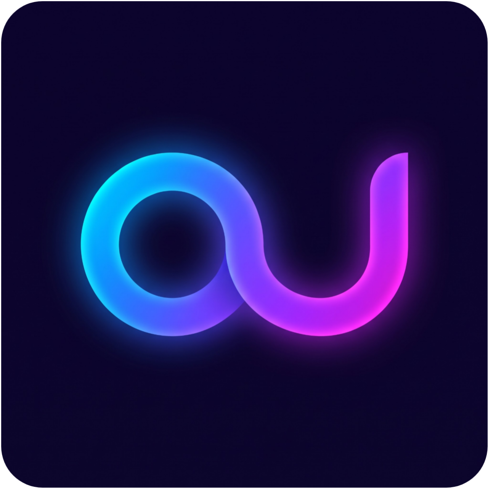

# ouMusic Core 🎵

<p align="center">
  
</p>

<p align="center">
  <strong>Современный высокопроизводительный аудиоплеер и стриминговая платформа с синхронным караоке, динамической сферой звука M-Core, форматом .oump3 и поддержкой 240Hz экранов.</strong>
</p>

<p align="center">
  <a href="https://oulan1.github.io/ouMusic/"></a>
  <a href="https://t.me/ouMusicCore"></a>
  
  
  
</p>

---

## 🌟 Ключевые возможности

### 🎤 Синхронное караоке (стиль Яндекс Музыки)
- **Фирменный шрифт `YSMusic`**: Крупная выразительная типографика с идеальной читаемостью.
- **Стабильность строк**: Нулевое смещение слов при смене уровней текста — длинные строки сразу переносятся и сохраняют геометрию.
- **Интеллектуальная анимация ухода**: Пропетые строки плавно затухают и уменьшаются к центру, освобождая внимание для активного куплета.
- **Свободная прокрутка**: Просмотр текста трека колёсиком мыши или свайпом с автоматическим возвратом к текущей строке через 3 секунды.
- **Чистый контраст**: Отсутствие раздражающих неоновых ореолов — чёткие белые акценты на затемнённом фоне.

---

### 🌊 Моя Волна и визуализатор M-Core DSP
- **Аудиореактивная сфера**: Динамическая геометрия с частотным анализом Web Audio API, реагирующая на бочку, бас и ритм.
- **Умная адаптивная волна за обложкой**: Деликатный и спокойный контур в тихих моментах и мощный импульсивный всплеск на дропах.
- **Фильтры потока**: Настройка под настроение (работа, релакс, тренировка), характер звучания и язык треков.
- **Жесты управления**: Свайп влево — следующий трек, свайп вправо — дизлайк с временным красным свечением, тап по центру — пауза/воспроизведение.

---

### 📂 Плейлисты и сообщество (.oulist)
- **Вкладка «Плейлисты» на главной**: Подборки треков сообщества прямо из папки `playlists/`.
- **Продвинутый редактор плейлистов**:
  - Быстрая смена названия, описания и собственной обложки.
  - **Drag & Drop упорядочивание**: Перетаскивание треков пальцем или мышью за 6 точек слева.
  - **Автоскролл у границ**: Плавная автопрокрутка списка при поднесении трека к верхнему или нижнему краю.
- **Формат `.oulist`**: Экспорт и импорт плейлистов в универсальном JSON-формате в один клик.

---

### ⚡ Режим оптимизации и встроенный тест производительности (Антуту)
- **Режим «Эко / Производительность»**: Полное отключение тяжелых шейдеров и фоновых холстов для идеальной плавности на бюджетных смартфонах.
- **Диагностический тест совместимости**:
  - Измерение реального фреймрейта рендеринга (60 / 120 / 144 / 240 FPS).
  - Проверка стабильности и отсутствия фризов.
  - Замер задержки аудиодвижка DSP (&lt; 4.2 мс) и числа доступных потоков процессора.
  - Итоговый балл (100/100) и персонализированные рекомендации.

---

### 🎨 Дизайн: Жидкое стекло (Liquid Glass) и Адаптивный цвет
- **Спекулярное стекло visionOS / iOS**: Глубокое размытие, оптическое преломление и тактильные блики на элементах интерфейса.
- **Динамическая палитра**: Автоматическое извлечение доминирующего цвета обложки и перекрашивание интерфейса под атмосферу текущего трека.
- **Безупречные SVG-заглушки**: Минималистичные нейтральные иконки для исполнителей, обложек и профилей вместо стандартных пустых картинок.

---

### 📦 Контейнер `.oump3` и Студия
- Единый контейнер (Lossless аудио FLAC/320k MP3 + LRC-текст песни + HD обложка + DSP-настройки инструментала).
- Встроенная студия сборки треков с модерацией качества и таймингов.

---

## 🚀 Быстрый старт (1-Click)

Для локального запуска и добавления своей музыки:

1. Склонируйте репозиторий:
   ```bash
   git clone https://github.com/oulan1/ouMusic.git
   cd ouMusic
   ```

2. Запустите универсальный мастер-скрипт:
   - Дважды кликните по **`ouMusic.bat`** (Windows)

> `ouMusic.bat` автоматически:
> 1. Просканирует и проиндексирует треки (`tracks/*.oump3`) и общие плейлисты (`playlists/*.oulist`).
> 2. Синхронизирует каталог с GitHub Pages при наличии изменений.
> 3. Запустит локальный сервер на `http://localhost:8080` и сразу откроет приложение в вашем браузере.

---

## 🛠️ Стек технологий

- **Фронтенд**: Pure Vanilla JavaScript (ES2024), HTML5, CSS3 Tokens (Material Design 3 + Apple visionOS Specular Glass).
- **Звук и DSP**: Web Audio API (AnalyserNode, BiquadFilter, Convolver, DynamicsCompressor, MediaStream).
- **Хранилище**: IndexedDB (локальное кэширование полноразмерного аудио для 100% офлайн воспроизведения).
- **Офлайн**: Service Worker Cache API (PWA), Web App Manifest, MediaSession API.
- **Типографика**: Фирменный шрифт `YSMusic Headline Bold`.

---

## 💬 Сообщество и связь

Присоединяйтесь к официальному Telegram-каналу для получения свежих обновлений, новостей о релизах и участия в обсуждениях:

👉 **[t.me/ouMusicCore](https://t.me/ouMusicCore)**

---

<p align="center">
  Разработано с душой для истинных ценителей качественной музыки и плавного интерфейса.
</p>
